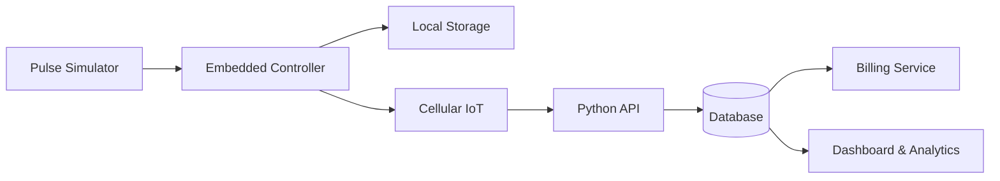

<!--
  Smart Gas Meter IoT
  Languages: English | فارسی | Deutsch
-->

# Smart Gas Meter IoT

### A modular, safety-conscious smart metering research prototype

**Embedded Systems · Custom PCB · Cellular IoT · Automated Billing · Data Analytics**

  
  
  
  
  

[Overview](#english) · [فارسی](#فارسی) · [Deutsch](#deutsch) · [Architecture](#architecture) · [Safety](#safety)

[Interactive Project Gallery](hardware/visualization/project-gallery.html) · [3D Concept View](hardware/visualization/smart-gas-meter-exploded.html) · [Visual Design Notes](hardware/visualization/README.md) · [Requirements](docs/requirements.md) · [Architecture Details](docs/architecture.md) · [Development API](docs/api-development.md) · [Production Architecture](docs/production-product-architecture.md) · [Design Decisions v1](hardware/design-decisions-v1.md) · [Release Readiness](hardware/release-readiness.md) · [Pinout & Test Points](hardware/pinout-and-testpoints-v0.2.md) · [AI, Billing & Tamper Requirements](docs/ai-billing-and-tamper-requirements.md) · [Telemetry Contract](docs/telemetry-contract.md) · [Telemetry JSON Schema](schemas/telemetry.schema.json) · [Board v0.1 Design](hardware/board-v0.1-design.md) · [Schematic Plan](hardware/board-v0.2-schematic-plan.md) · [Cellular Modem Interface](hardware/modem-daughterboard-interface.md) · [Board BOM](hardware/BOM-board-v0.1.md) · [Board Netlist Draft](hardware/board-v0.1-netlist-draft.csv) · [Native KiCad Schematic Draft](hardware/kicad/smart_gas_meter_iot.kicad_sch) · [CAD Reference Attribution](hardware/kicad/REFERENCE_ATTRIBUTION_AND_STATUS.md) · [v0.2 Netlist Draft](hardware/kicad/board-v0.2-netlist-draft.csv) · [v0.2 PCB Layout Plan](hardware/kicad/board-v0.2-layout-plan.md) · [PCB Layout Checklist](hardware/board-v0.1-layout-checklist.md) · [Bring-up Test Plan](hardware/board-v0.1-bringup-test-plan.md) · [Initial BOM](hardware/BOM-draft.md) · [Pulse Simulator Spec](hardware/pulse-simulator-spec.md) · [Software Simulator](simulator/pulse_simulator.py) · [Send Synthetic Data to API](simulator/push_to_api.py)

---

## 🇬🇧 English

### Overview

**Smart Gas Meter IoT** is a proposed end-to-end prototype for exploring how embedded electronics, simulated meter pulses, cellular connectivity, and a Python backend can work together to monitor consumption and prepare billing records.

The project is being developed as a practical engineering portfolio: from circuit and PCB design to firmware, data services, a dashboard, and analytics. **This repository is at an early stage; planned features are not yet claimed as implemented.**

### Current engineering baseline

- ESP32-S3-WROOM-1-N8 is a candidate controller, not a frozen component choice.
- Cellular communication is planned through a separate modem interface so the modem can be selected after checking the target region, operator, bands and certification path.
- The board direction is a larger, test-friendly four-layer design, subject to electrical and layout review.
- Early tests must use synthetic pulses and isolated low-voltage circuits only.
- AI anomaly flags are advisory and cannot establish that a gas leak exists.
- Billing output remains a prototype report until metrology and legal requirements are established.

### Planned capabilities

- Embedded controller, local storage, timekeeping and status indicators.
- Safe pulse simulation without connecting to a live gas meter.
- Cellular telemetry with local queueing and retry after reconnect.
- Python API, database, device records and validation.
- Traceable draft invoices with tariff versioning and QR verification.
- Consumption trends, forecasts, anomaly flags, tamper/fault events and device-health monitoring.
- Engineering documentation, native schematic, PCB layout, 3D assembly views and test plans.

### Development roadmap

- [x] Draft initial requirements and system interfaces.
- [x] Specify simulator acceptance tests and add a software telemetry fixture.
- [x] Add unit tests for the simulator and GitHub Actions CI workflow.
- [x] Define the versioned telemetry contract and JSON Schema.
- [x] Document the initial controller/board concept, cellular interface, product architecture, pinout proposal and release gates.
- [x] Add a standalone interactive isometric concept illustration (not CAD-derived or fabrication-ready).\n- [ ] Create and verify native KiCad schematic.
- [ ] Create and verify routed KiCad PCB and actual 3D assembly/exploded views.
- [ ] Complete BOM with exact parts, footprints and approved alternates.
- [ ] Run and review electrical-rule and design-rule checks.
- [ ] Export and inspect Gerbers, drill, assembly and pick-and-place files.
- [x] Add a development-only FastAPI + SQLite ingestion API with duplicate-safe records, bearer-token protection, pulse-delta reporting and a local dashboard (`/dashboard`).
- [ ] Add per-device identity/credentials, production database hardening, firmware, billing and analytics.
- [ ] Run recorded low-voltage bench tests and later region-specific radio validation.
- [ ] Complete qualified safety, metrology, EMC, radio, cybersecurity and regulatory reviews.

---

## 🇮🇷 فارسی

### معرفی پروژه

**کنتور گاز هوشمند اینترنت اشیا (Smart Gas Meter IoT)** پروژه‌ای برای ارتقای یک ایده سخت‌افزاری قدیمی با رویکرد مهندسی جدید است؛ از طراحی برد و ارتباط سلولی تا ثبت داده، تحلیل مصرف و تولید گزارش صورتحساب.

### تصمیم‌های طراحی فعلی

- میکروکنترلر ESP32-S3-WROOM-1-N8 گزینه اولیه است و تا بررسی مدار نهایی، قطعه قطعی محسوب نمی‌شود.
- مودم سیم‌کارتی به‌صورت ماژول جداشدنی طراحی می‌شود تا انتخاب مدل به پوشش شبکه، اپراتور، باندها و تأییدیه‌ها وابسته بماند.
- جهت طراحی برد، نمونه‌ای بزرگ‌تر و چهارلایه با نقاط تست فراوان است؛ تعداد لایه‌ها و ابعاد پس از طراحی و بررسی نهایی می‌شود.
- آزمون اولیه فقط با پالس مصنوعی و مدار کم‌ولتاژ ایزوله انجام می‌شود.
- تحلیل ناهنجاری مصرف به‌تنهایی اثبات‌کننده نشت گاز نیست.
- صورتحساب تا تعیین الزامات قانونی و اندازه‌گیری، گزارش آزمایشی است.

### وضعیت واقعی پروژه

مستندات معماری، نیازمندی‌ها، رابط مودم، نگاشت اولیه پایه‌ها و برنامه آمادگی ساخت در مخزن قرار گرفته‌اند. اما **شماتیک بومی KiCad، PCB مسیریابی‌شده، نمای سه‌بعدی استخراج‌شده از CAD و فایل‌های ساخت هنوز تولید و اعتبارسنجی نشده‌اند**؛ بنابراین پروژه هنوز آماده سفارش PCB یا مونتاژ نیست.

### نقشه راه

- [x] تدوین نیازمندی‌ها، معماری و قرارداد داده.
- [x] ساخت شبیه‌ساز نرم‌افزاری، ابزار ارسال داده مصنوعی به API و آزمون‌های خودکار.
- [x] مستندسازی تصمیم‌های اولیه برد، رابط مودم، نقاط تست و معیارهای آماده‌سازی ساخت.
- [x] افزودن API آزمایشی FastAPI و SQLite با توکن دسترسی، جلوگیری از تکرار، گزارش اختلاف شمارنده پالس و داشبورد محلی (`/dashboard`).
- [ ] افزودن هویت و اعتبارنامه مستقل برای هر دستگاه، سخت‌سازی پایگاه داده، فریم‌ور و صورتحساب واقعی.\n- [ ] ساخت شماتیک واقعی KiCad و بررسی ERC.
- [ ] طراحی و مسیریابی PCB و بررسی DRC.
- [ ] استخراج نمای سه‌بعدی مونتاژ و انفجاری از مدل واقعی PCB.
- [ ] تکمیل BOM، فوت‌پرینت‌ها و قطعات جایگزین.
- [ ] تولید و بررسی Gerber، فایل سوراخ‌کاری و فایل‌های مونتاژ.
- [ ] اجرای آزمون‌های ثبت‌شده با مدار کم‌ولتاژ.
- [ ] ارزیابی تخصصی ایمنی، اندازه‌گیری، رادیویی، EMC و مقررات پیش از استفاده عملیاتی.

---

## 🇩🇪 Deutsch

Smart Gas Meter IoT is a modular engineering prototype for simulated pulse acquisition, cellular telemetry, data analysis and draft billing. The repository documents the intended design and separates documented proposals from implemented and verified hardware.

The current baseline proposes an ESP32-S3 controller, a modular cellular interface and a larger test-friendly PCB. A development-only FastAPI + SQLite service and local dashboard now accept/view synthetic telemetry, require a shared bearer token for data endpoints, and reject conflicting duplicate sequences. It is not production-secure and does not yet provide per-device credentials. Native KiCad files, a routed PCB, CAD-derived 3D views and manufacturing outputs are not yet available or validated. Only isolated low-voltage laboratory tests using synthetic pulses are in scope at this stage.

---

## System architecture / معماری سیستم

This is the planned architecture, not a claim that all components have been implemented.

## Safety and scope / ایمنی

- Laboratory prototype only. Use simulated pulses and low-voltage test circuits.
- Do not connect this prototype to a live gas line, operational meter, mains wiring or unknown field signals.
- This project is not a certified measuring instrument, leak detector, billing authority or safety device.
- Real deployment requires qualified review and applicable metrology, gas-safety, radio, EMC, cybersecurity and local regulatory compliance.
- No component ordering or fabrication is authorized without explicit owner approval.

## Project history / سابقه پروژه

In 1396 SH (2017–2018), the project owner personally designed and built an original smart gas meter prototype for Iran Gas Company in Shahrekord, Chaharmahal and Bakhtiari Province, Iran. This repository documents a modernized development effort; historical work must not be confused with new features that remain unimplemented or untested.

## License

No license has been selected yet. Until a license is added, the repository should not be assumed to grant permission to reuse, modify or distribute its contents.

### v0.2 hardware design drafts
- [Candidate pin-to-net map (CSV)](hardware/kicad/board-v0.2-netlist-draft.csv)
- [PCB placement and routing plan](hardware/kicad/board-v0.2-layout-plan.md)
- [Native KiCad delivery gate](hardware/kicad/NATIVE_CAD_DELIVERY_GATE.md)

These are engineering drafts, not a completed electrical schematic, routed PCB, or fabrication package. ERC/DRC and component-level verification remain release gates.
