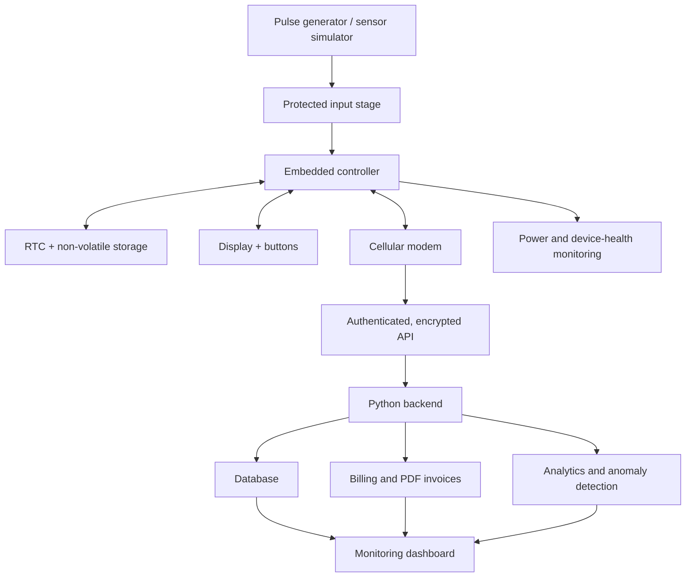

# Smart Gas Meter IoT
### An open engineering prototype for connected utility metering, reliable data, automated billing, and consumption analytics

<p align="center">
  <strong>Embedded Systems · Custom PCB · IoT · Python · Data Engineering · Applied AI</strong>
</p>

<p align="center">
  <a href="#overview">Overview</a> ·
  <a href="#project-goals">Goals</a> ·
  <a href="#system-architecture">Architecture</a> ·
  <a href="#roadmap">Roadmap</a> ·
  <a href="#safety-and-scope">Safety</a> ·
  <a href="#readme-in-23-languages">23 languages</a>
</p>

> **Project status: Early-stage design and prototyping.** The architecture and roadmap are proposals; hardware, firmware, backend, and test results will be added and verified as implementation progresses.

## Overview

**Smart Gas Meter IoT** is an engineering project to develop a modular, connected gas-metering *laboratory prototype*. It combines embedded electronics, a custom printed circuit board (PCB), simulated pulse-based measurement, cellular connectivity, a Python backend, automated billing, and consumption analytics.

The first version uses a **pulse generator or sensor simulator**. It will not connect to a live gas line or modify a certified utility meter. The long-term goal is to build a well-documented platform that demonstrates the path from circuit design and 3D assembly visualization to firmware, cloud services, testing, and product-oriented engineering documentation.

## Project goals

- Design a modular electronics architecture and custom PCB.
- Capture simulated meter pulses with reliable counting and event timestamps.
- Explore an embedded controller, real-time clock (RTC), non-volatile storage, display, power monitoring, and cellular modem.
- Build a Python API and data backend for device telemetry.
- Generate six-month consumption summaries and itemized PDF invoices from configurable tariff rules.
- Visualize readings, device health, communication status, and billing history in a dashboard.
- Explore anomaly detection and consumption forecasting using clearly labeled sample/simulated data.
- Test recovery from power loss, network outages, duplicate messages, invalid readings, and clock errors.
- Publish schematics, a bill of materials (BOM), PCB manufacturing outputs, 3D assembly views, tests, and design decisions as they become available.

## System architecture



### Planned hardware modules

| Module | Candidate / approach | Purpose |
|---|---|---|
| Controller | ESP32-S3 development platform for the first prototype | Pulse processing, device logic, and peripheral interfaces |
| Measurement input | Laboratory pulse generator or isolated simulator | Safe, repeatable test readings |
| Input conditioning | Protection, filtering, and suitable signal conditioning | Improve input robustness; final design depends on signal levels |
| Timekeeping | RTC module with backup supply | Timestamping and schedule support |
| Local storage | Non-volatile memory | Buffer readings and recover after outages |
| Connectivity | Region-compatible LTE modem; select LTE-M/NB-IoT only where supported | Send telemetry to the backend |
| User interface | Small OLED/LCD and buttons | Local status and basic interaction |
| Power subsystem | Designed DC input/regulation and voltage monitoring | Stable operation and power diagnostics |
| Enclosure | CAD-designed enclosure for a laboratory prototype | Mechanical protection and assembly validation |

These are **candidate modules, not a frozen bill of materials**. Exact part numbers, footprints, power budgets, antenna placement, electrical protection, environmental requirements, and manufacturing constraints must be reviewed before the PCB is finalized. A general-purpose ESP32 prototype is not, by itself, certified gas-metering or hazardous-area equipment.

## Planned software

- **Embedded firmware:** pulse counting, input validation, device state, local buffering, and communication recovery.
- **Backend:** Python with FastAPI (planned), a documented API, validation, and device identity.
- **Data storage:** PostgreSQL (planned) for readings, device events, tariff versions, and invoice records.
- **Billing:** configurable tariff rules, six-month summaries, traceable calculations, and PDF output.
- **Dashboard:** device health, consumption trends, connectivity, alerts, and billing history.
- **Analytics:** baseline comparisons, anomaly flags, and forecasting experiments using simulated or explicitly authorized data.
- **Quality:** automated tests, linting, API tests, and reproducible simulation scenarios.

## Reliability, privacy, and security principles

1. Validate incoming readings and reject malformed or implausible messages.
2. Give each reading and upload a stable identifier to help prevent duplicate processing.
3. Store tariff versions and calculation inputs so invoices can be audited and reproduced.
4. Buffer readings locally when the network is unavailable and define a tested resynchronization strategy.
5. Authenticate devices and encrypt data in transit; never commit real credentials, SIM identifiers, personal information, or production secrets.
6. Log security-relevant events while limiting collection of personal data.
7. Treat AI output as decision support, not as proof of a gas leak or a safety condition.
8. Keep any real-world shutoff or safety function outside this prototype unless designed, reviewed, and certified under the applicable requirements by qualified professionals.

## Safety and scope

This repository is for **research, education, and laboratory prototyping**. Use a pulse generator, switch-based simulator, or other safe electrical test fixture. Do not connect this prototype to a live gas line, bypass a utility meter, or use it as a certified billing instrument.

Gas-metering products and electronics installed in potentially explosive atmospheres may be subject to metrology, electrical safety, explosion-protection, radio, and local regulatory requirements. Those requirements depend on the target country and product design. A successful software test or 3D render does not establish compliance, measurement accuracy, or operational safety.

## Roadmap

- [ ] Define requirements, assumptions, and acceptance criteria
- [ ] Publish system block diagram and interface definitions
- [ ] Select and document candidate components
- [ ] Draw the first schematic and review power/input protection
- [ ] Create the PCB layout and verify footprints/design rules
- [ ] Generate 3D board assembly and enclosure concept
- [ ] Implement pulse simulation and firmware tests
- [ ] Implement the Python API and database schema
- [ ] Add offline buffering and reconnect/replay tests
- [ ] Implement versioned tariffs and six-month PDF invoices
- [ ] Add dashboard and sample-data analytics
- [ ] Document build instructions, test results, and known limitations

Roadmap checkboxes will be marked complete only when the relevant artifact or test is present in the repository.

## Repository structure (planned)

```text
smart-gas-meter-iot/
├── docs/                 # Architecture, safety notes, decisions, interfaces
├── hardware/
│   ├── schematics/       # Circuit diagrams
│   ├── pcb/              # PCB project and manufacturing exports
│   ├── 3d/               # Board assembly and enclosure CAD
│   └── bom/              # Bill of materials
├── firmware/             # Embedded firmware and tests
├── backend/              # Python API, domain logic, and database
├── dashboard/            # Monitoring UI
├── analytics/            # Reproducible experiments on sample data
├── simulator/            # Pulse and telemetry simulator
├── tests/                # Integration and end-to-end tests
└── README.md
```

The tree describes the intended organization; folders and implementations will be added incrementally.

## Development principles

- Design in small, reviewable, testable steps.
- Keep hardware interfaces and software contracts documented.
- Separate simulated readings from any future real sensor data.
- Avoid claiming accuracy, safety, certification, or production readiness without evidence.
- Prefer reproducible tests and documented engineering decisions over screenshots alone.

## Contributing

Early feedback on architecture, embedded design, PCB review, Python services, testing, documentation, and translation quality is welcome. For substantial changes, open an issue first to discuss the intended behavior. Never submit private user data, credentials, or unsafe instructions for live gas equipment.

## License

No license has been selected yet. Until a license file is added, assume that standard copyright applies and that reuse, distribution, and modification are not automatically granted.

---

## Readme in 23 languages

This section provides a localized project summary and scope statement in 23 languages. The English section above is the primary technical specification; translated summaries may be refined as the design evolves.

### 1. English

**Smart Gas Meter IoT** is an open engineering prototype combining embedded systems, custom PCB design, simulated pulse measurement, cellular IoT, Python services, automated six-month billing, dashboards, and consumption analytics. The project is at the early design stage. The first prototype is laboratory-only and must not be connected to a live gas line or treated as a certified meter.

### 2. فارسی — Persian

**کنتور گاز هوشمند اینترنت اشیا** پروژه‌ای مهندسی برای توسعهٔ نمونهٔ آزمایشگاهی و ماژولار است که طراحی برد اختصاصی، اندازه‌گیری شبیه‌سازی‌شده بر پایهٔ پالس، ارتباط سلولی، نرم‌افزار Python، صدور خودکار صورتحساب شش‌ماهه، داشبورد و تحلیل مصرف را ترکیب می‌کند. پروژه در مرحلهٔ طراحی اولیه است. نمونهٔ نخست فقط برای آزمایشگاه ساخته می‌شود و نباید به خط گاز واقعی متصل شود یا به‌عنوان کنتور تأییدشده استفاده شود.

### 3. Deutsch — German

**Smart Gas Meter IoT** ist ein technischer Laborprototyp für eingebettete Systeme, eine kundenspezifische Leiterplatte, simulierte Impulsmessung, Mobilfunk-IoT, Python-Dienste, automatische halbjährliche Abrechnungen, Dashboards und Verbrauchsanalysen. Das Projekt befindet sich in einer frühen Entwurfsphase. Der erste Prototyp ist ausschließlich für den Laborbetrieb vorgesehen und darf weder an eine aktive Gasleitung angeschlossen noch als geeichter Zähler verwendet werden.

### 4. Français — French

**Smart Gas Meter IoT** est un prototype d’ingénierie destiné au laboratoire. Il associe systèmes embarqués, carte électronique personnalisée, mesure par impulsions simulées, connectivité cellulaire IoT, services Python, facturation automatique semestrielle, tableaux de bord et analyse de consommation. Le projet est en phase de conception initiale. Le premier prototype est réservé au laboratoire et ne doit pas être raccordé à une conduite de gaz en service ni être considéré comme un compteur certifié.

### 5. Español — Spanish

**Smart Gas Meter IoT** es un prototipo de ingeniería para laboratorio que combina sistemas embebidos, una PCB personalizada, medición mediante pulsos simulados, conectividad IoT celular, servicios Python, facturación semestral automática, paneles de control y análisis del consumo. El proyecto se encuentra en una fase inicial de diseño. El primer prototipo es exclusivamente de laboratorio: no debe conectarse a una tubería de gas activa ni utilizarse como contador certificado.

### 6. Italiano — Italian

**Smart Gas Meter IoT** è un prototipo ingegneristico da laboratorio che integra sistemi embedded, PCB personalizzata, misurazione tramite impulsi simulati, connettività cellulare IoT, servizi Python, fatturazione semestrale automatica, dashboard e analisi dei consumi. Il progetto è nelle prime fasi di progettazione. Il primo prototipo è destinato esclusivamente al laboratorio e non deve essere collegato a una linea del gas attiva né considerato un contatore certificato.

### 7. Português — Portuguese

**Smart Gas Meter IoT** é um protótipo de engenharia para laboratório que combina sistemas embarcados, PCB personalizada, medição por pulsos simulados, conectividade celular IoT, serviços Python, faturação semestral automática, painéis de controlo e análise de consumo. O projeto está numa fase inicial de conceção. O primeiro protótipo destina-se exclusivamente ao laboratório e não deve ser ligado a uma tubagem de gás ativa nem utilizado como contador certificado.

### 8. Nederlands — Dutch

**Smart Gas Meter IoT** is een technisch laboratoriumprototype dat embedded systemen, een eigen PCB, gesimuleerde pulsm meting, mobiele IoT-connectiviteit, Python-services, automatische halfjaarlijkse facturatie, dashboards en verbruiksanalyse combineert. Het project bevindt zich in een vroege ontwerpfase. Het eerste prototype is uitsluitend bedoeld voor laboratoriumgebruik en mag niet op een actieve gasleiding worden aangesloten of als gecertificeerde meter worden gebruikt.

### 9. Svenska — Swedish

**Smart Gas Meter IoT** är en teknisk laboratorieprototyp som kombinerar inbyggda system, ett anpassat kretskort, simulerad pulsmätning, mobil IoT-anslutning, Python-tjänster, automatisk halvårsvis fakturering, instrumentpaneler och förbrukningsanalys. Projektet befinner sig i ett tidigt designskede. Den första prototypen är endast avsedd för laboratoriebruk och får inte anslutas till en aktiv gasledning eller användas som en certifierad mätare.

### 10. Norsk — Norwegian

**Smart Gas Meter IoT** er en teknisk laboratorieprototype som kombinerer innebygde system, et spesialdesignet kretskort, simulert pulsmåling, mobil IoT-kommunikasjon, Python-tjenester, automatisk halvårlig fakturering, dashbord og forbruksanalyse. Prosjektet er i en tidlig designfase. Den første prototypen er kun beregnet for laboratoriebruk og må ikke kobles til en aktiv gassledning eller brukes som en sertifisert måler.

### 11. Dansk — Danish

**Smart Gas Meter IoT** er en teknisk laboratorieprototype, der kombinerer indlejrede systemer, et specialdesignet printkort, simuleret pulsmåling, mobil IoT-forbindelse, Python-tjenester, automatisk halvårlig fakturering, dashboards og forbrugsanalyse. Projektet er i en tidlig designfase. Den første prototype er kun til laboratoriebrug og må ikke tilsluttes en aktiv gasledning eller anvendes som en certificeret måler.

### 12. Suomi — Finnish

**Smart Gas Meter IoT** on laboratoriokäyttöön tarkoitettu tekninen prototyyppi, jossa yhdistyvät sulautetut järjestelmät, oma piirilevy, simuloitu pulssimittaus, mobiili IoT-yhteys, Python-palvelut, automaattinen puolivuosittainen laskutus, hallintanäkymät ja kulutusanalytiikka. Projekti on varhaisessa suunnitteluvaiheessa. Ensimmäinen prototyyppi on tarkoitettu vain laboratorioon, eikä sitä saa liittää toimivaan kaasuputkeen tai käyttää sertifioituna mittarina.

### 13. Polski — Polish

**Smart Gas Meter IoT** to laboratoryjny prototyp inżynierski łączący systemy wbudowane, dedykowaną płytkę PCB, symulowany pomiar impulsowy, łączność komórkową IoT, usługi Python, automatyczne rozliczenia półroczne, panele kontrolne i analizę zużycia. Projekt znajduje się na wczesnym etapie projektowania. Pierwszy prototyp jest przeznaczony wyłącznie do laboratorium i nie może być podłączany do czynnej instalacji gazowej ani używany jako certyfikowany licznik.

### 14. Čeština — Czech

**Smart Gas Meter IoT** je laboratorní technický prototyp, který propojuje vestavěné systémy, vlastní desku plošných spojů, simulované měření impulzů, mobilní IoT komunikaci, služby Python, automatické pololetní vyúčtování, řídicí panely a analýzu spotřeby. Projekt je v počáteční fázi návrhu. První prototyp je určen pouze pro laboratoř a nesmí být připojen k aktivnímu plynovému potrubí ani používán jako certifikované měřidlo.

### 15. Українська — Ukrainian

**Smart Gas Meter IoT** — це інженерний лабораторний прототип, що поєднує вбудовані системи, спеціальну друковану плату, симульоване вимірювання імпульсів, стільниковий IoT-зв’язок, сервіси Python, автоматичне піврічне виставлення рахунків, панелі моніторингу та аналіз споживання. Проєкт перебуває на початковому етапі проєктування. Перший прототип призначений лише для лабораторії: його не можна підключати до діючого газопроводу або використовувати як сертифікований лічильник.

### 16. Русский — Russian

**Smart Gas Meter IoT** — инженерный лабораторный прототип, объединяющий встраиваемые системы, специализированную печатную плату, имитацию импульсных измерений, сотовую IoT-связь, сервисы Python, автоматическое полугодовое выставление счетов, панели мониторинга и анализ потребления. Проект находится на ранней стадии проектирования. Первый прототип предназначен только для лаборатории: его нельзя подключать к действующему газопроводу или использовать как сертифицированный счётчик.

### 17. Türkçe — Turkish

**Smart Gas Meter IoT**, gömülü sistemleri, özel tasarlanmış PCB'yi, simüle edilmiş darbe ölçümünü, hücresel IoT bağlantısını, Python servislerini, otomatik altı aylık faturalandırmayı, gösterge panellerini ve tüketim analizini bir araya getiren laboratuvar amaçlı bir mühendislik prototipidir. Proje erken tasarım aşamasındadır. İlk prototip yalnızca laboratuvarda kullanılmalıdır; çalışan bir gaz hattına bağlanmamalı ve sertifikalı sayaç olarak kullanılmamalıdır.

### 18. العربية — Arabic

**Smart Gas Meter IoT** هو نموذج هندسي أولي مخصص للمختبر، يجمع بين الأنظمة المضمنة ولوحة دوائر مطبوعة مخصصة وقياس نبضات مُحاكى واتصال إنترنت الأشياء عبر الشبكات الخلوية وخدمات Python والفوترة النصف سنوية التلقائية ولوحات المتابعة وتحليل الاستهلاك. لا يزال المشروع في مرحلة التصميم المبكرة. النموذج الأول مخصص للمختبر فقط، ويُمنع توصيله بخط غاز عامل أو استخدامه كعداد معتمد.

### 19. हिन्दी — Hindi

**Smart Gas Meter IoT** एक प्रयोगशाला-आधारित इंजीनियरिंग प्रोटोटाइप है, जिसमें एम्बेडेड सिस्टम, कस्टम PCB, सिम्युलेटेड पल्स मापन, सेल्युलर IoT कनेक्टिविटी, Python सेवाएँ, स्वचालित छह-महीने की बिलिंग, डैशबोर्ड और खपत विश्लेषण शामिल हैं। परियोजना अभी शुरुआती डिज़ाइन चरण में है। पहला प्रोटोटाइप केवल प्रयोगशाला में उपयोग के लिए है; इसे चालू गैस पाइपलाइन से नहीं जोड़ना चाहिए और प्रमाणित मीटर के रूप में उपयोग नहीं करना चाहिए।

### 20. 简体中文 — Simplified Chinese

**Smart Gas Meter IoT（智能燃气表物联网）** 是一个面向实验室的工程原型项目，结合嵌入式系统、定制 PCB、模拟脉冲测量、蜂窝物联网通信、Python 服务、自动半年账单、监控仪表板和用量分析。项目目前处于早期设计阶段。首个原型仅供实验室测试，不得连接正在运行的燃气管道，也不得作为经过认证的计量设备使用。

### 21. 日本語 — Japanese

**Smart Gas Meter IoT（スマートガスメーター IoT）** は、組み込みシステム、専用 PCB、模擬パルス計測、セルラー IoT 通信、Python サービス、半年ごとの自動請求、ダッシュボード、使用量分析を組み合わせた研究・試作用プロジェクトです。現在は初期設計段階です。最初の試作機は実験室専用であり、稼働中のガス配管に接続したり、認証済み計量器として使用したりしてはいけません。

### 22. 한국어 — Korean

**Smart Gas Meter IoT**는 임베디드 시스템, 맞춤형 PCB, 시뮬레이션 펄스 측정, 셀룰러 IoT 통신, Python 서비스, 자동 반기 청구, 대시보드 및 사용량 분석을 결합한 실험실용 엔지니어링 프로토타입입니다. 프로젝트는 초기 설계 단계에 있습니다. 첫 번째 프로토타입은 실험실에서만 사용해야 하며, 실제 가스 배관에 연결하거나 인증된 계량기로 사용해서는 안 됩니다.

### 23. Bahasa Indonesia — Indonesian

**Smart Gas Meter IoT** adalah prototipe rekayasa untuk laboratorium yang menggabungkan sistem embedded, PCB khusus, pengukuran pulsa simulasi, konektivitas IoT seluler, layanan Python, penagihan otomatis setiap enam bulan, dasbor, dan analisis konsumsi. Proyek ini masih berada pada tahap desain awal. Prototipe pertama hanya untuk penggunaan laboratorium dan tidak boleh dihubungkan ke saluran gas aktif atau digunakan sebagai meter bersertifikat.

---

## Keywords

`smart-meter` `gas-meter` `embedded-systems` `pcb-design` `iot` `esp32` `python` `fastapi` `telemetry` `billing-automation` `data-analytics` `predictive-maintenance` `electronics`

---

<p align="center">
  <sub>Built step by step with an engineering-first mindset. Hardware and software status will be documented honestly as the project evolves.</sub>
</p>
