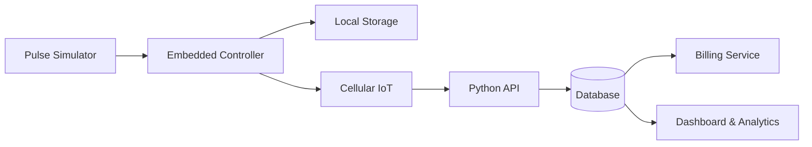

<!--
  Smart Gas Meter IoT
  Languages: English | فارسی | Deutsch
-->

# Smart Gas Meter IoT

### A modular, safety-conscious smart metering research prototype

**Embedded Systems · Custom PCB · Cellular IoT · Automated Billing · Data Analytics**

  
  
  
  
  

[Overview](#english) · [فارسی](#فارسی) · [Deutsch](#deutsch) · [Architecture](#architecture) · [Safety](#safety)

[Requirements](docs/requirements.md) · [Architecture Details](docs/architecture.md) · [Telemetry Contract](docs/telemetry-contract.md) · [Telemetry JSON Schema](schemas/telemetry.schema.json) · [Board v0.1 Design](hardware/board-v0.1-design.md) · [Board BOM](hardware/BOM-board-v0.1.md) · [Board Netlist Draft](hardware/board-v0.1-netlist-draft.csv) · [PCB Layout Checklist](hardware/board-v0.1-layout-checklist.md) · [Bring-up Test Plan](hardware/board-v0.1-bringup-test-plan.md) · [Initial BOM](hardware/BOM-draft.md) · [Pulse Simulator Spec](hardware/pulse-simulator-spec.md) · [Software Simulator](simulator/pulse_simulator.py)

---

## 🇬🇧 English

### Overview

**Smart Gas Meter IoT** is a proposed end-to-end prototype for exploring how embedded electronics, simulated meter pulses, cellular connectivity, and a Python backend can work together to monitor consumption and prepare billing records.

The project is being developed as a practical engineering portfolio: from circuit and PCB design to firmware, data services, a dashboard, and analytics. **This repository is at an early stage; planned features are not yet claimed as implemented.**

### Planned capabilities

- **Embedded device:** microcontroller-based controller, timekeeping, local data storage, and status indicators.
- **Safe pulse simulation:** a test input that generates synthetic meter pulses without connecting to a live gas meter.
- **Connectivity:** a cellular IoT module for sending prototype data to a backend.
- **Data platform:** Python API, database, device records, and validation.
- **Billing workflow:** configurable consumption calculations and six-month statement generation using simulated data.
- **Dashboard and analytics:** consumption charts, reporting, anomaly flags, and trend analysis.
- **Engineering documentation:** requirements, bill of materials (BOM), schematic, PCB layout, assembly views, and test plans.

### Proposed technology stack

| Layer | Candidate technologies |
|---|---|
| Embedded firmware | ESP32-class MCU, C/C++ |
| Prototype input | Isolated low-voltage pulse simulator |
| Connectivity | LTE / cellular IoT module, selected after requirements review |
| Backend API | Python, FastAPI |
| Data storage | PostgreSQL; local storage for offline buffering |
| Dashboard | Web dashboard and consumption visualizations |
| Analytics | Python, pandas; anomaly detection as a later milestone |
| Hardware design | Schematic capture, PCB layout, 3D assembly review |

*These are design candidates, not a declaration that the hardware has been built or validated.*

### Development roadmap

- [x] Draft initial requirements and system interfaces ([document](docs/requirements.md))
- [x] Prepare a preliminary component shortlist and BOM ([draft](hardware/BOM-draft.md); exact parts still pending)
- [x] Specify simulator acceptance tests and add a software telemetry fixture ([spec](hardware/pulse-simulator-spec.md), [code](simulator/pulse_simulator.py))
- [x] Add unit tests for the software simulator and a GitHub Actions CI workflow ([tests](tests/test_pulse_simulator.py), [workflow](.github/workflows/tests.yml)); local test run passed
- [x] Define a versioned telemetry contract and JSON Schema ([documentation](docs/telemetry-contract.md), [schema](schemas/telemetry.schema.json))
- [x] Define the first custom-board architecture, candidate MCU module, power block, lab-only pulse input, pin map, and preliminary BOM ([design baseline](hardware/board-v0.1-design.md), [BOM](hardware/BOM-board-v0.1.md)); CAD and validation are still pending
- [ ] Verify exact footprints and power-stage component values against current datasheets
- [ ] Create KiCad schematic and custom PCB layout
- [ ] Review 3D board assembly and enclosure clearances
- [ ] Implement firmware and local event logging
- [ ] Build the Python API and database schema
- [ ] Add simulated consumption calculations and six-month reports
- [ ] Build dashboard, automated tests, and deployment documentation
- [ ] Evaluate security, fault handling, and data integrity

---

## 🇮🇷 فارسی

### معرفی پروژه

**کنتور گاز هوشمند اینترنت اشیا (Smart Gas Meter IoT)** یک پروژه نمونه‌سازی مهندسی است که با هدف بررسی ارتباط میان الکترونیک و طراحی برد اختصاصی، سیستم‌های نهفته، ارتباط سلولی، پردازش داده و صدور صورتحساب طراحی شده است.

هدف، ساخت یک نمونه آزمایشگاهی قابل توسعه و مستندسازی‌شده است؛ از انتخاب قطعات و طراحی شماتیک و PCB گرفته تا توسعه فریم‌ور، بک‌اند پایتون، داشبورد و تحلیل مصرف. **پروژه در مرحله ابتدایی توسعه قرار دارد و قابلیت‌های آینده به‌عنوان امکانات پیاده‌سازی‌شده معرفی نمی‌شوند.**

### قابلیت‌های برنامه‌ریزی‌شده

- **سخت‌افزار نهفته:** میکروکنترلر، ساعت داخلی، ذخیره‌سازی محلی و نشانگرهای وضعیت.
- **شبیه‌ساز پالس ایمن:** تولید پالس مصنوعی برای آزمایش، بدون اتصال به کنتور یا خط واقعی گاز.
- **ارتباط اینترنت اشیا:** ارسال داده‌های نمونه از طریق ماژول ارتباط سلولی.
- **بک‌اند پایتون:** API، پایگاه داده، ثبت دستگاه‌ها و اعتبارسنجی اطلاعات.
- **صورتحساب خودکار:** محاسبه مصرف نمونه و تولید گزارش‌های شش‌ماهه با تعرفه‌های قابل تنظیم.
- **داشبورد و تحلیل:** نمودار مصرف، گزارش‌گیری، شناسایی داده‌های غیرعادی و بررسی روندها.
- **مستندات مهندسی:** فهرست قطعات (BOM)، شماتیک، طراحی PCB، نمای سه‌بعدی مونتاژ و برنامه آزمون.

### فناوری‌های پیشنهادی

| بخش | فناوری پیشنهادی |
|---|---|
| سیستم نهفته | میکروکنترلر از خانواده ESP32 و زبان C/C++ |
| ورودی آزمایشی | شبیه‌ساز پالس با ولتاژ پایین و حفاظت ورودی |
| ارتباطات | ماژول سلولی / LTE پس از نهایی‌شدن نیازمندی‌ها |
| API | Python و FastAPI |
| پایگاه داده | PostgreSQL و ذخیره‌سازی محلی برای زمان قطع ارتباط |
| داشبورد | پنل وب و نمودارهای مصرف |
| تحلیل داده | Python و pandas؛ تشخیص ناهنجاری در مراحل بعدی |
| طراحی سخت‌افزار | شماتیک، PCB و بررسی سه‌بعدی مونتاژ |

*موارد بالا گزینه‌های طراحی هستند؛ به معنی ساخته‌شدن یا تأیید نهایی سخت‌افزار نیستند.*

### نقشه راه توسعه

- [x] تدوین اولیه نیازمندی‌ها و رابط‌های سیستم ([مستند](docs/requirements.md))
- [x] تهیه پیش‌نویس فهرست قطعات BOM ([پیش‌نویس](hardware/BOM-draft.md)؛ انتخاب نهایی قطعات باقی است)
- [x] تعریف آزمون‌های شبیه‌ساز و افزودن ابزار نرم‌افزاری داده مصنوعی ([مشخصات](hardware/pulse-simulator-spec.md)، [کد](simulator/pulse_simulator.py))
- [x] افزودن آزمون‌های واحد برای شبیه‌ساز نرم‌افزاری و گردش CI در GitHub Actions ([آزمون‌ها](tests/test_pulse_simulator.py)، [گردش‌کار](.github/workflows/tests.yml))؛ اجرای محلی آزمون‌ها موفق بود
- [x] تعریف قرارداد نسخه‌دار داده و JSON Schema ([مستند](docs/telemetry-contract.md)، [طرح JSON](schemas/telemetry.schema.json))
- [x] تعریف معماری اولیه برد اختصاصی، ماژول میکروکنترلر پیشنهادی، بخش تغذیه، ورودی پالس آزمایشگاهی، نگاشت پایه‌ها و BOM اولیه ([مبنای طراحی](hardware/board-v0.1-design.md)، [فهرست قطعات](hardware/BOM-board-v0.1.md))؛ طراحی CAD و اعتبارسنجی هنوز انجام نشده است
- [ ] بررسی فوت‌پرینت‌ها و مقادیر قطعات تغذیه با دیتاشیت‌های رسمی
- [ ] ترسیم شماتیک در KiCad و طراحی PCB اختصاصی
- [ ] بررسی سه‌بعدی جانمایی قطعات و ابعاد محفظه
- [ ] پیاده‌سازی فریم‌ور و ثبت رویدادها
- [ ] توسعه API پایتون و ساختار پایگاه داده
- [ ] پیاده‌سازی محاسبه مصرف نمونه و گزارش شش‌ماهه
- [ ] ساخت داشبورد، آزمون‌های خودکار و مستندات اجرا
- [ ] بررسی امنیت، مدیریت خطا و صحت داده‌ها

---

## 🇩🇪 Deutsch

### Projektübersicht

**Smart Gas Meter IoT** ist ein geplantes, modular aufgebautes Labor- und Lernprojekt. Es untersucht, wie eingebettete Elektronik, simulierte Zählerimpulse, Mobilfunkkommunikation und ein Python-Backend zu einer prototypischen Verbrauchserfassung und Abrechnung kombiniert werden können.

Das Projekt soll als nachvollziehbares Engineering-Portfolio entstehen – von der Bauteilauswahl und dem Schaltplan über das kundenspezifische PCB-Layout bis hin zu Firmware, Backend, Dashboard und Datenanalyse. **Das Repository befindet sich in einer frühen Entwicklungsphase. Geplante Funktionen werden nicht als bereits implementiert dargestellt.**

### Geplante Funktionen

- **Embedded-System:** Mikrocontroller, Echtzeituhr, lokaler Datenspeicher und Statusanzeigen.
- **Sichere Impulssimulation:** künstliche Zählimpulse für Tests, ohne Verbindung zu einem realen Gaszähler.
- **Konnektivität:** Mobilfunk-/IoT-Modul zur Übertragung von Prototypdaten.
- **Python-Backend:** API, Datenbank, Geräteverwaltung und Datenvalidierung.
- **Automatisierte Abrechnung:** konfigurierbare Verbrauchsberechnung und halbjährliche Abrechnungsberichte mit simulierten Daten.
- **Dashboard und Analytik:** Verbrauchsdiagramme, Berichte, Anomaliehinweise und Trendanalysen.
- **Technische Dokumentation:** Anforderungen, Stückliste (BOM), Schaltplan, PCB-Layout, 3D-Montageansichten und Testpläne.

### Vorgesehener Technologie-Stack

| Ebene | Mögliche Technologien |
|---|---|
| Embedded-Firmware | ESP32-Klasse, C/C++ |
| Testeingang | Geschützter Niederspannungs-Impulssimulator |
| Kommunikation | LTE / Mobilfunk-IoT-Modul, Auswahl nach Anforderungsanalyse |
| Backend-API | Python, FastAPI |
| Datenspeicherung | PostgreSQL; lokaler Pufferbetrieb |
| Dashboard | Weboberfläche und Verbrauchsvisualisierung |
| Datenanalyse | Python, pandas; spätere Anomalieerkennung |
| Hardwareentwicklung | Schaltplan, PCB-Layout und 3D-Montageprüfung |

*Dies sind vorgesehene Technologieoptionen und keine Aussage über bereits aufgebaute oder validierte Hardware.*

### Entwicklungsplan

- [ ] Anforderungen und Systemschnittstellen definieren
- [ ] Bauteile auswählen und eine dokumentierte Stückliste erstellen
- [ ] Niederspannungs-Impulssimulator und Eingangsschutz entwerfen
- [ ] Schaltplan und kundenspezifisches PCB-Layout erstellen
- [ ] 3D-Baugruppenansicht und Gehäuseabstände prüfen
- [ ] Firmware und lokale Ereignisprotokollierung implementieren
- [ ] Python-API und Datenbankschema entwickeln
- [ ] Verbrauchssimulation und halbjährliche Berichte ergänzen
- [ ] Dashboard, automatisierte Tests und Betriebsdokumentation erstellen
- [ ] Sicherheit, Fehlerbehandlung und Datenintegrität bewerten

---

## System Architecture / معماری سیستم / Systemarchitektur

The diagram represents the **planned architecture**. Interfaces and component choices will be refined as requirements and prototypes are validated.

## Safety & Scope / ایمنی و محدوده پروژه / Sicherheit und Umfang

- **Laboratory prototype only.** Use simulated pulses and low-voltage test circuits.
- Do not connect this prototype to a live gas line or modify a certified utility meter.
- This project is not a certified measuring instrument, billing authority, or safety device.
- Any future real-world deployment would require qualified engineering review, applicable certification, and compliance with local regulations.
- Protect device credentials, validate incoming data, and design for communication failures and safe recovery.

## Project History / سابقه پروژه / Projektgeschichte

### 🇬🇧 English

In **1396 SH (2017–2018)**, **I personally designed and built the original smart gas meter prototype** for **Iran Gas Company** in **Shahrekord, Chaharmahal and Bakhtiari Province, Iran**. Today, I am revisiting and upgrading **the same original project** using my current technical knowledge and modern engineering practices. The goal is to improve its hardware design, software architecture, telemetry, data management, and analytical capabilities while preserving the original project's foundation.

The current repository describes this updated development effort. The historical prototype should not be confused with the new implementation: hardware, firmware, and software features are marked as planned until they are implemented and tested in this repository.

### 🇮🇷 فارسی

من در سال **۱۳۹۶ شمسی (۲۰۱۷–۲۰۱۸ میلادی)**، نسخهٔ اولیهٔ کنتور هوشمند گاز را **شخصاً طراحی و ساختم**؛ این نمونه برای **شرکت گاز ایران** در **شهرکرد، استان چهارمحال و بختیاری** ساخته شد.

اکنون در حال بازبینی و به‌روزرسانی **همان پروژهٔ اولیه** با دانش فنی امروز و روش‌های مهندسی جدید هستم. هدف، ارتقای طراحی سخت‌افزار، معماری نرم‌افزار، ارسال داده، مدیریت اطلاعات و قابلیت‌های تحلیل داده، با حفظ پایهٔ اصلی پروژه است.

این مخزن، مسیر توسعه و به‌روزرسانی فعلی پروژه را مستند می‌کند. نمونه تاریخی سال ۱۳۹۶ را نباید با پیاده‌سازی جدید اشتباه گرفت؛ قابلیت‌های سخت‌افزاری و نرم‌افزاری جدید تا زمان پیاده‌سازی و آزمون، به‌عنوان قابلیت تکمیل‌شده معرفی نمی‌شوند.

### 🇩🇪 Deutsch

Im Jahr **1396 SH (2017–2018)** habe **ich den ursprünglichen Prototyp des intelligenten Gaszählers persönlich entworfen und gebaut** – für die **Iran Gas Company** in **Shahrekord, Provinz Chaharmahal und Bakhtiari, Iran**.

Heute überarbeite und erweitere ich **dasselbe ursprüngliche Projekt** mit meinem aktuellen technischen Wissen und modernen Engineering-Methoden. Ziel ist es, Hardwaredesign, Softwarearchitektur, Telemetrie, Datenverwaltung und Analysefunktionen weiterzuentwickeln und dabei die ursprüngliche Grundlage des Projekts zu erhalten.

Dieses Repository dokumentiert die aktuelle Weiterentwicklung. Der historische Prototyp ist von der neuen Implementierung zu unterscheiden: Neue Hardware- und Softwarefunktionen gelten erst dann als umgesetzt, wenn sie in diesem Repository implementiert und getestet wurden.

---

## Contributing

Issues and pull requests are welcome for documentation, simulation, firmware architecture, backend services, testing, and hardware design.

## License

No license has been selected yet. Until a license is added, the repository should not be assumed to grant permission to reuse, modify, or distribute its contents.

---

**Designed as an engineering learning project — built step by step, documented transparently.**

English · فارسی · Deutsch

