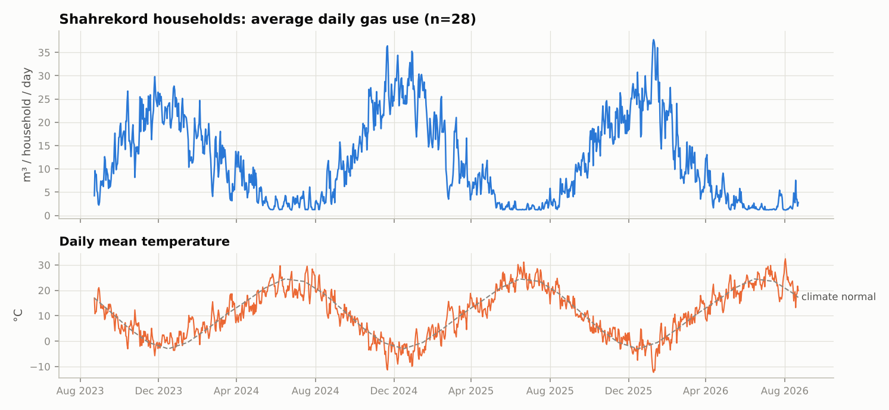
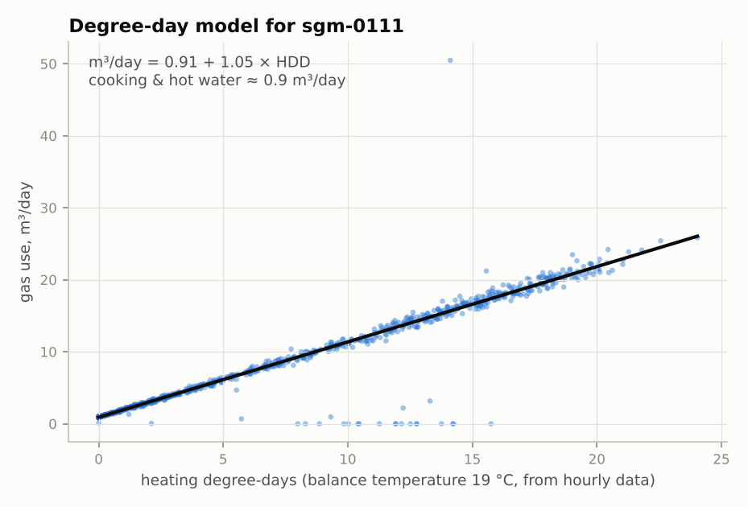
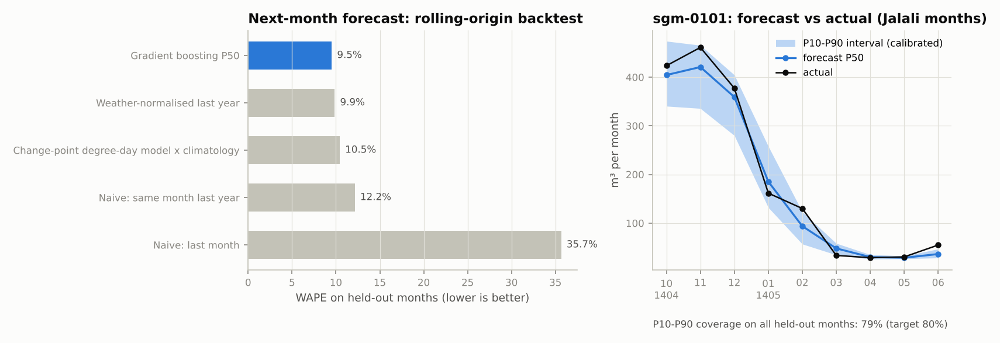
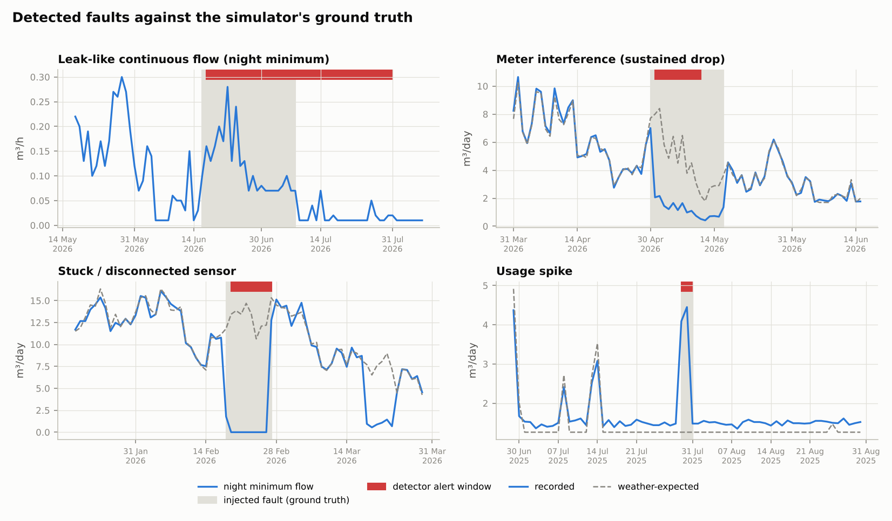
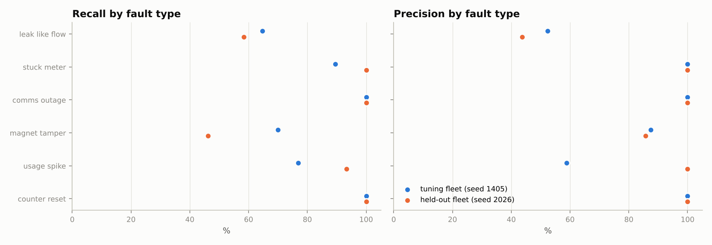

# Analytics report: synthetic smart-gas-meter fleet

> **Everything here is synthetic.** A simulated fleet exercises the software end to end. These are not field
> measurements, the tariff is illustrative, and an anomaly flag is never proof of a gas leak.

Generated by `python -m sgm_analytics.pipeline --publish ../docs/analytics` from `analytics/`. The fleet has 240 households in 6
Iranian cities, simulated hour by hour from 2023-09-23 to 2026-09-23, producing 6,311,568 meter readings.

## 1. Fleet and weather

Hourly gas use comes from a building-physics model. Space heating is driven by heating degree-hours, scaled by floor area,
insulation, thermostat set-point, night set-back and weekday absence. Cooking and hot water follow a daily profile and
grow with occupants and cold inlet water. Households travel during Nowruz and occasionally during the year. Weather is a
city climatology with persistent day-to-day anomalies (AR(1)), so cold spells last several days.

## 2. Data quality before anything else (AI-002)

Cumulative pulse counts are turned into interval volumes, with flags for duplicates, gaps, counter resets and physically
implausible flow (above the G4 meter's 6 m³/h Qmax). Flags travel with the numbers. Billing and analytics read the flags;
they never "fix" data silently.

## 3. Per-household degree-day model (expected consumption)

Each household gets a robust (Huber) change-point model, `m³/day = a + b × HDD(T_base)`. The balance temperature `T_base`
is chosen per household (PRISM-style). The model gives the *weather-expected* consumption that the forecasts and the
anomaly detectors compare against.

## 4. Next-month forecast with uncertainty (AI-004)

A global gradient-boosting model predicts P10/P50/P90 consumption for the next Jalali month from lags, the household's
degree-day parameters and climatological HDD (the target month's weather is unknown at forecast time). Evaluation is a
rolling-origin backtest that trains strictly on earlier months, compared with honest baselines:

| method | WAPE | median APE |
|---|---|---|
| Gradient boosting P50 (gbr-quantile-v1) | 9.5% | 6.5% |
| Change-point degree-day model x climatology | 10.5% | 7.2% |
| Weather-normalised last year | 9.9% | 6.6% |
| Naive: same month last year | 12.2% | 8.5% |
| Naive: last month | 35.7% | 25.5% |

P10-P90 interval coverage on held-out months: **79%** (target 80%). Weather-normalised last-year consumption is a
strong baseline. The boosted model matches its median error and adds calibrated intervals.

## 5. Fault and anomaly detection (AI-003, AI-006, AI-007)

Each detector is explainable, and every alert carries its reason, time window, baseline, deviation and data quality.

| Detector | Logic |
|---|---|
| continuous_flow | CUSUM on the night-time minimum flow, standardised by a level-dependent (heteroscedastic) scale |
| zero_while_expected | no pulses for ≥2 days while the weather model expects clear use |
| sustained_drop | ≥5 days at a steady 10-45 % of the expected level with normal hourly variability. Travel drops to ~0 % with erratic use; interference scales the whole profile |
| usage_spike | ratio > 2, robust z > 6 and a jump against the previous week's median |
| data_gap / counter_reset | straight from the data-quality layer |
| unusual_day | Isolation Forest on residual features (low confidence, not scored) |

Event-level precision and recall against the simulator's ground-truth labels (±2 days):

**Tuning fleet (seed 1405):**

| label | detector | labelled_events | detected | recall | alerts | precision |
|---|---|---|---|---|---|---|
| leak_like_flow | continuous_flow | 17 | 11 | 65% | 21 | 52% |
| stuck_meter | zero_while_expected | 19 | 17 | 89% | 18 | 100% |
| comms_outage | data_gap | 11 | 11 | 100% | 11 | 100% |
| magnet_tamper | sustained_drop | 10 | 7 | 70% | 8 | 88% |
| usage_spike | usage_spike | 13 | 10 | 77% | 17 | 59% |
| counter_reset | counter_reset | 11 | 11 | 100% | 11 | 100% |

**Held-out fleet (seed 2026, never used for tuning):**

| label | detector | labelled_events | detected | recall | alerts | precision |
|---|---|---|---|---|---|---|
| leak_like_flow | continuous_flow | 12 | 7 | 58% | 16 | 44% |
| stuck_meter | zero_while_expected | 14 | 14 | 100% | 15 | 100% |
| comms_outage | data_gap | 10 | 10 | 100% | 10 | 100% |
| magnet_tamper | sustained_drop | 13 | 6 | 46% | 7 | 86% |
| usage_spike | usage_spike | 15 | 14 | 93% | 16 | 100% |
| counter_reset | counter_reset | 8 | 8 | 100% | 8 | 100% |

Forecast on the held-out fleet:

| method | WAPE | median APE |
|---|---|---|
| Gradient boosting P50 (gbr-quantile-v1) | 11.1% | 8.4% |
| Change-point degree-day model x climatology | 12.7% | 9.1% |
| Weather-normalised last year | 12.9% | 9.4% |
| Naive: same month last year | 12.8% | 9.3% |
| Naive: last month | 37.6% | 28.1% |

P10-P90 coverage: 82%

The detector thresholds were tuned on the seed-1405 fleet only. The seed-2026 fleet is a held-out check of how well they
generalise. Diagnosis drove each change, and the false alarms were inspected rather than tuned away: the first
interference detector fired on Nowruz travel (3 % precision). It now separates travel from interference by the level band
and the hourly variability.

## 6. Billing (BILL-001 … BILL-008)

Each invoice uses a versioned **illustrative** tariff. It has four standard tiers measured against a regional, monthly
consumption pattern (the median household m³/day over prior years, quality-OK days only), cold- and warm-season prices, a
fixed charge, tax and rounding. Billing periods are half-open Jalali months in Asia/Tehran. Each invoice stores its
calculation trace, is marked *PROVISIONAL* when data is missing, reset or under an open fault alert, and carries an
HMAC-signed QR verification token with no personal data.

Sample invoices (bilingual PDF + JSON with trace): [`invoices/`](invoices/).

## Limitations

- The simulator's physics and fault models are plausible, not calibrated against field data. Detector performance on real
  meters will differ and must be re-measured before any alert is shown to a customer (AI-007).
- Labels are synthetic and evaluation is event-level with ±2 days of slack.
- Monthly city temperatures are rounded climate approximations, not an authoritative climate dataset.
- Tariff numbers are placeholders. Official billing stays blocked until metrology, tariff and legal approval (BILL-008).
