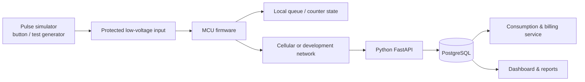

# System Architecture

**Status:** Draft v0.1  
**Style:** Modular, event-oriented prototype  
**Safety boundary:** Synthetic pulse data and low-voltage laboratory hardware only

## 1. Context

This prototype demonstrates a data path from a simulated pulse source to a device counter, backend ingestion, storage, and reporting. It is not a certified meter and must not be connected to live gas infrastructure.

## 2. Component responsibilities

### Pulse simulator
Generates known, repeatable synthetic events. It is a test fixture, not a sensor connected to a gas meter. Test cases include slow pulses, bursts, switch bounce, and network interruption.

### Embedded firmware
- Conditions and counts input events.
- Maintains a cumulative count.
- Assigns a device ID and sequence number to readings.
- Records basic health information.
- Buffers unsent events where supported.
- Reports reset, clock-sync, and connectivity state explicitly.

### Transport
Start with USB serial or a local network. Add cellular communication after the firmware and backend are stable. Transport must not change the meaning of a reading.

### Backend API
- Validates payload schema and device identity.
- Applies idempotency rules.
- Stores raw readings before derived calculations.
- Separates telemetry from consumption and invoice records.
- Exposes versioned endpoints and health checks.

### Database
Stores device metadata, raw telemetry, conversion configuration, derived consumption intervals, billing periods, and report metadata. Raw readings should remain auditable.

### Billing and reporting
Calculates differences between valid cumulative counts, applies a versioned simulated conversion factor and tariff configuration, and generates a report for a selected six-month interval. It flags gaps and counter resets.

### Dashboard
Shows connection state, latest readings, cumulative pulses, simulated consumption, anomalies, and report history. It is a monitoring interface, not a safety control.

## 3. Interface contract

| Field | Type | Meaning |
|---|---|---|
| `schema_version` | integer | Payload schema version |
| `device_id` | string | Stable synthetic device identifier |
| `sequence` | integer | Increasing reading/event sequence |
| `timestamp` | ISO-8601 string or null | UTC time if clock quality permits |
| `uptime_ms` | integer | Time since boot |
| `pulse_count_total` | integer | Cumulative synthetic pulse count |
| `input_mode` | string | Must identify simulated input in this prototype |

### Proposed API (not implemented yet)

- `GET /health` — process health.
- `POST /api/v1/readings` — submit a reading.
- `GET /api/v1/devices/{device_id}/latest` — latest accepted reading.
- `GET /api/v1/reports/consumption?start=...&end=...` — simulated consumption summary.

Authentication and transport security must be designed before exposing the API beyond a local test environment.

## 4. Data integrity rules

1. Identify each reading by device and sequence, or another documented stable event key.
2. Retries must be idempotent.
3. Store raw telemetry before creating derived consumption records.
4. A decreasing counter must raise a reset/rollover condition, not silently create negative consumption.
5. Do not interpolate missing readings silently.
6. Record the conversion factor and tariff version used for each report.
7. Store timestamps in UTC and use an explicit timezone for user-facing reporting periods.

## 5. Failure modes to test

| Failure | Expected behavior |
|---|---|
| Network unavailable | Buffer and retry where supported, without duplicate ingestion. |
| Duplicate message | Do not double-count the event. |
| Out-of-order sequence | Reject or quarantine according to a documented policy. |
| Counter decreases | Flag reset/rollover and pause derived consumption calculation. |
| Unsynchronized clock | Preserve uptime and mark timestamp quality. |
| Invalid payload | Return validation error and avoid invalid derived records. |
| Backend restart | Previously committed raw readings remain available. |
| Power loss | Measure and document recovery; do not claim zero loss before testing. |

## 6. Security baseline

- Never commit API keys, SIM PINs, passwords, or device secrets.
- Use environment variables for local backend secrets.
- Require authenticated submissions before non-local deployment.
- Use TLS for remote transport and validate server identity.
- Validate and bound all input fields.
- Keep public examples synthetic.
- Avoid logging credentials or unnecessary personal data.

## 7. Decisions to revisit

- MCU module and pin allocation.
- Modem choice, antenna requirements, supported bands, and regional carrier availability.
- Flash/FRAM/SD strategy for buffering and endurance.
- RTC choice and clock synchronization.
- MQTT versus HTTPS for remote telemetry.
- Device provisioning and firmware update strategy.
- Enclosure, EMC, environmental, and certification requirements for any future product.

## 8. Current implementation status

| Component | Status |
|---|---|
| Project README | Published |
| Requirements and architecture documents | Initial draft |
| Firmware | Not implemented |
| Schematic / PCB | Not implemented |
| Backend / database | Not implemented |
| Dashboard / billing | Not implemented |
| Hardware validation | Not performed |

Update this table only when a corresponding artifact or test exists.
