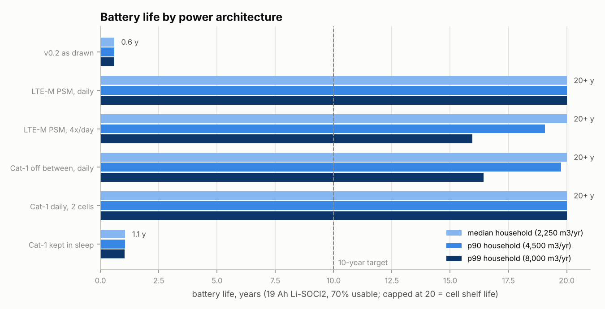

# Hardware decisions for v0.3

**Status: proposal. The three decisions below are the project owner's to make.**
Each option is costed with the same assumptions; the recommendation says which
one the numbers favour and why.

> **خلاصه فارسی.** سه تصمیم برای نسخه ۰٫۳ باقی است: (۱) تغذیه — باتری یا برق شهر؛ (۲) رابط پالس کنتور؛ (۳) مودم و شبکه در ایران.
> بُرد فعلی (۰٫۲) اگر با باتری کار کند کمتر از یک سال دوام می‌آورد، چون مودم بین ارسال‌ها روشن می‌ماند و مقاومت بالاکش ۱۰ کیلواهم ممکن است دائم جریان بکشد.
> با خواب عمیق، بالاکش یک مگااهمی و یک ارسال در روز، یک باتری لیتیوم-تیونیل‌کلرید سایز D بیش از ده سال کار می‌کند؛ چه با LTE-M (BG95) و چه با Cat-1 خاموش‌شونده (EC200U).
> چون پوشش سراسری LTE-M/NB-IoT در ایران تأیید نشده است، پیشنهاد ما فوترپینت مشترک برای BG95-M3 و EC200U-EU روی بُرد دختر مودم و شروع آزمایش با Cat-1 است.
> اتصال به کنتور واقعی فقط پس از طراحی ایمنی ذاتی (Ex ia) و تأیید شرکت گاز مجاز است؛ این پروژه همچنان فقط روی میز آزمایش با پالس ۳٫۳ ولت مصنوعی کار می‌کند.

---

## 1. Power: battery or mains

### What the numbers say

`hardware/power/power_budget.py` models average current as a sleep floor plus
per-pulse and per-upload charge, for the simulated fleet's median, 90th and 99th
percentile households (2,250 / 4,500 / 8,000 m³ per year at 0.01 m³ per pulse).

| Architecture (median household) | Average current | Life on one 19 Ah D-cell |
|---|---:|---:|
| v0.2 board as drawn, run from a battery | 2,571 µA | **0.6 years** |
| Deep sleep, pulse wake, BG95-M3 LTE-M in PSM, 1 upload/day | 36 µA | 20+ years (cell-limited) |
| Same, 4 uploads/day | 70 µA | 20+ years at median, 16 at p99 |
| Deep sleep, EC200U Cat-1 powered off between daily uploads | 67 µA | 20+ years at median, 16 at p99 |
| Cat-1 left registered in sleep (no PSM) | 1,432 µA | **1.1 years** |

Full tables for all three households: [`hardware/power/power-budget.md`](../hardware/power/power-budget.md).

Three findings drive the design:

1. **The radio's idle floor decides everything.** A modem kept registered draws
   1.4–1.9 mA in sleep (Quectel datasheets), 50× the rest of the board. It must be
   in PSM or physically switched off between uploads.
2. **The pull-up can drain the battery on its own.** A meter can stop with the
   magnet parked on the reed, holding the contact closed for days. Through the
   v0.2 10 kΩ pull-up that is 330 µA, ten times the whole recommended budget.
   Use ≥1 MΩ, or arm the pull-up only around sampling.
3. **Pulse wake-ups matter for heavy users.** At the 99th percentile, waking on
   every pulse costs 36 µA, more than the uploads. The ESP32-S3 ULP coprocessor can
   count pulses on GPIO4 (an RTC GPIO) without waking the main cores; worth it if the
   heavy-user tail matters.

### Options

| | Mains (5 V adapter, today's v0.2) | Battery (Li-SOCl₂ + hybrid layer capacitor) |
|---|---|---|
| Installation | Needs a socket or cable run at the meter box, which in Iran is often outdoors on the façade or boundary wall | Self-contained, sealed enclosure |
| Safety near gas | Mains wiring at a gas meter needs its own hazardous-area review | Low energy, easier to make intrinsically safe |
| Power cut | Device stops; counter safe in flash, pulses during the cut are lost | Keeps counting |
| Firmware | Works as built (Wi-Fi or cellular, hourly upload) | Needs deep sleep, PSM/power-off modem control, ULP or wake-per-pulse |
| Cost | Adapter + cable, cheap | Cell + HLC ≈ the most expensive part of the BOM |

**Recommendation: battery** for anything beyond the bench, because a gas meter
installation cannot assume a socket and should not bring mains wiring to the meter.
Keep the USB 5 V input on the bench board for development. Bobbin Li-SOCl₂ cells
cannot deliver 200 mA+ modem bursts, so the cell needs a hybrid layer capacitor
(or a supercapacitor with a current-limited charger).

## 2. Meter pulse interface

| | Reed contact (e.g. Elster IN-Z61 style) | Hall / magnetometer | Optical reader on the index |
|---|---|---|---|
| Signal | Dry contact, closes once per revolution of the last drum; min closure 0.25 s | Needs powered sensor (µA–mA) | Needs LED pulses and image/reflectance processing |
| Fits v0.2 input | Yes: J2 + pull-up + series R + debounce in firmware | Needs a sensor board | No |
| Tamper | Separate NC alarm contact on IN-Z6x-type pulsers maps to J3 | Detects external magnets directly | Detects cover removal |
| Power | Zero at rest with a high-value pull-up | Continuous | Highest |

**Recommendation: reed contact**, which the firmware already supports (30 ms
minimum closure, bounce merged, closure-at-boot ignored, pulses faster than Qmax
flagged). Typical G4 index value is 0.01 m³ per pulse, but **the pulse constant must
be confirmed for each meter model** before any volume is billed; the backend keeps
raw pulse counts for exactly this reason.

**Boundary that does not move:** a cable to a real meter's pulser runs into a
potentially explosive atmosphere. That needs an intrinsically safe (Ex ia) input
with a certified barrier and the gas company's approval. Until then the input stays
a 3.3 V bench signal.

## 3. Modem and network in Iran

What we could establish:

- Iranian operators run LTE on B1, B3, B7 and B8 (plus TDD bands); 2G remains on
  900/1800 MHz ([frequency checker](https://www.kimovil.com/en/frequency-checker/IR)).
- National LTE-M or NB-IoT coverage in Iran was not confirmed on the GSMA map in a
  Nordic support thread ([DevZone](https://devzone.nordicsemi.com/f/nordic-q-a/48953/activate-lte-in-iran/195151));
  that thread is old, so the operator must be asked directly.
- Cellular devices used in Iran are subject to IMEI registration in the national
  registry (Hamta) ([Zoomit](https://www.zoomit.ir/tech-iran/286471-tablet-simcard-registry/));
  confirm how this applies to embedded modules before buying a batch.

| | Quectel BG95-M3 | Quectel EC200U-EU |
|---|---|---|
| Radio | LTE Cat-M1 / NB2 + EGPRS fallback | LTE Cat-1 + GSM |
| Bands relevant to Iran | M1/NB: B3, B8, B20…; 2G 900/1800 | FDD B1/B3/B7/B8 (+B20/B28), TDD B38/40/41; GSM 900/1800 |
| Power-saving | PSM 3.9 µA, eDRX | Sleep 1.4 mA, no PSM listed: switch off between uploads |
| TX current | 193 mA at 21 dBm | Higher (Cat-1 PA); size the HLC accordingly |
| Works today in Iran | Only on 2G fallback until LTE-M/NB is offered | On existing LTE |
| Firmware | `uplink_cell.c` (same Quectel AT set) | Same driver |

Sources: [Quectel BG95 specification V1.7](https://sixfab.com/wp-content/uploads/2023/06/Quectel_BG95_Series_LPWA_Specification_V1.7.pdf),
[Quectel EC200U specification V1.4](https://python.quectel.com/en/wp-content/uploads/sites/2/2024/11/Quectel_EC200U_Series_LTE_Standard_Specification_V1.4.pdf).

**Recommendation:** give the modem daughterboard footprints for **both** (the J6
interface and the AT driver already fit either), start field trials on **EC200U-EU
powered off between daily uploads** because it uses today's LTE, and switch to
**BG95-M3 in PSM** if an operator confirms LTE-M/NB-IoT with PSM for an IoT SIM.
The power model shows both meet a 10-year life with one upload per day.

---

## Proposed v0.3 changes (if the recommendations are accepted)

| Area | Change | Why |
|---|---|---|
| Power | Battery input (3.6 V Li-SOCl₂ + HLC) with reverse-polarity protection; keep USB 5 V for bench | No mains at the meter |
| Power | Replace the 5 V→3.3 V buck with a low-Iq buck-boost or LDO (Iq ≤ 1 µA) | AP63203 Iq (22 µA) would be the largest constant term |
| Power | Load switch on MODEM_VIN, driven by MODEM_EN | Cat-1 has no PSM; switching it off saves 1.4 mA |
| Pulse | R5 10 kΩ → 1 MΩ (or switched pull-up), keep R6/C9 | Parked-magnet drain |
| Pulse | Route J2 to an RTC GPIO (GPIO4 already is) and keep it for ULP counting | Heavy-user tail |
| Tamper | Map the pulser's NC alarm contact to J3 | Free cable-cut / removal detection |
| Monitoring | Battery voltage divider (switched) to an ADC pin → `supply_mv` in telemetry v2 | Field battery health |
| Firmware | Deep sleep with ext wake or ULP counter; modem PSM / power-off; 1–4 uploads per day | Matches the model |

Rerun `python hardware/power/power_budget.py` after measuring a real upload session
with a current analyser; the session charges in the script are estimates.
