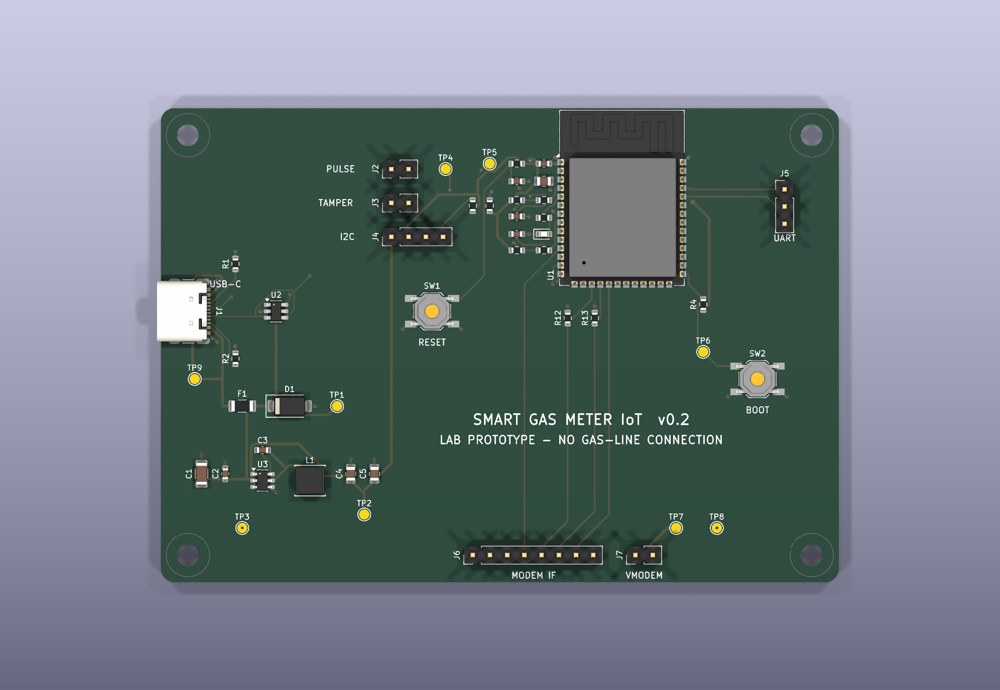
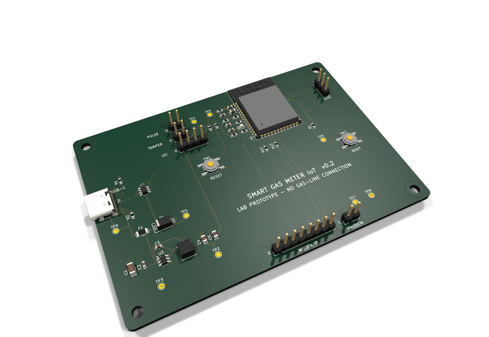

# PCB design — carrier board v0.2 (rev 0.2-rc1)

**Status: routed, DRC-clean engineering PCB for review. Not released for fabrication.**
Bench-only prototype: current-limited low-voltage supply and synthetic 3.3 V pulse source. Never connect it to a live gas meter, gas line, valve, mains or field wiring.

| | |
|---|---|
|  |  |

The renders are generated by KiCad 9 from the actual PCB and its vendored 3D models; they are not concept illustrations.

## Board

| Item | Value |
|---|---|
| Size | 100 × 70 mm, 2 mm corner radius, 4 × M3 mounting holes |
| Stack-up | 4 layers, 1.6 mm: **F.Cu** signals · **In1** solid GND plane (no tracks) · **In2** signals + 3V3 pour · **B.Cu** signals |
| Net classes | Default 0.25 mm / 0.2 mm clearance · Power (GND, +5V, +3V3, USB_VBUS, MODEM_VIN, REG_SW) 0.4 mm · USB pair 0.2 mm |
| Vias | 0.6 / 0.3 mm (power 0.8 / 0.4 mm); module thermal vias 0.2 mm drill (JLCPCB 4-layer capable) |
| Routing | 263 F.Cu + 49 B.Cu + 6 In2 segments, 48 vias (29 of them GND fan-out vias) |

## Placement rationale

- **ESP32-S3-WROOM-1** sits right of centre with its antenna end at the top edge. The stock footprint's antenna keep-out covered F.Cu/In1/B.Cu only; the vendored copy extends it to **all copper layers**, so no In2 pour runs under the antenna.
- The module's **left-hand pins** (EN, IO4–IO7, IO15, IO17/18, USB D−/D+) face the lab-interface cluster: pulse, LED, I2C and tamper parts plus their headers, then USB and power further left. Its **bottom-row** pins (IO9–IO11) face the modem header on the bottom edge, and its **right-hand** pins (IO0, UART0) face BOOT and the UART header.
- **USB-C** sits on the left edge, with the USBLC6 ESD array and the CC resistors next to it.
- The **AP63203 buck** (VIN caps → IC → L1 → output caps) is a compact loop in the lower-left corner. The switch node is 11.4 mm of copper, about 47 mm away from the pulse input.
- **Test points** TP1–TP9 cover 5V, 3V3, VBUS, VMODEM, GND (×2), PULSE_IN, EN and BOOT. RESET and BOOT buttons are reachable from the top.

## How the board is produced

1. `tools/build_pcb.py` (KiCad 9 Python) builds the board in four steps:
   - **Place:** footprints come from `pcb_layout_v02.py`, linked to the schematic symbols by UUID, with nets taken from `design_v02.py`.
   - **Fan out GND:** each SMD GND pad gets a short track and a via to In1, at a site checked for clearance.
   - **Add the rest:** outline, holes, silkscreen and zones.
   - **Route:** a Freerouting 2.1 round trip routes F.Cu, In2 and B.Cu; In1 is passed to the router as a plane-only layer.
2. Zones are filled on a reloaded board, because KiCad 9.0.3 misses NPTH knock-outs when it fills a board still held in memory.
3. `tools/export_pcb.sh` writes the DRC report (with schematic parity), Gerbers, Excellon drill and map, pick-and-place CSV, per-layer PDFs and 3D renders into `exports/pcb/`.

Autorouting isn't deterministic, so the committed `smart_gas_meter_iot.kicad_pcb` is the source of truth for copper. Make further changes in KiCad 9 and re-run the export.

## Verification (KiCad 9.0.3)

| Check | Result |
|---|---|
| DRC, all severities, with `--schematic-parity` | **0 violations, 0 unconnected pads, 0 parity issues** ([report](exports/pcb/drc-kicad-9.rpt)) |
| Schematic ERC | 0 errors, 0 warnings |
| Netlist vs `design_v02.py` | 48 parts / 28 nets / 135 connections match |
| Unit tests | placement table, board file (4 layers, all parts, no tracks on In1), antenna keep-out on all copper |

CI (`hardware-cad-check.yml`) repeats ERC, DRC with schematic parity, the netlist checks and the Gerber/drill exports with KiCad 9 on every push.

## Review items before any fabrication order

- [ ] **USB D+/D− pair:** the autorouter routed the pair as separate nets (66.0 mm vs 62.3 mm, about 3.7 mm skew). That is acceptable for USB 2.0 full-speed, but the pair should be hand-tuned as coupled 90 Ω differential routing against the chosen board-house stack-up.
- [ ] **Power path:** review AP63203 hot-loop layout and copper area for heat against the datasheet layout example; add input bulk capacitance if long USB cables are used.
- [ ] Overlay land patterns on the manufacturer drawings (USB4105, TSOT-26, SWPA4030, TL3342) and check 3D clearances.
- [ ] **Antenna area:** confirm the enclosure keeps metal away from it; consider extending the module over the board edge in v0.3.
- [ ] Choose a board house and apply its DFM rules (JLCPCB 4-layer assumed), then run its DFM check on the Gerbers.
- [ ] Second-engineer sign-off of schematic + PCB, then bench bring-up per `../board-v0.1-bringup-test-plan.md`.

The Gerbers in `exports/pcb/gerbers/` are **review artefacts**: do not order boards from them until the items above are closed.
