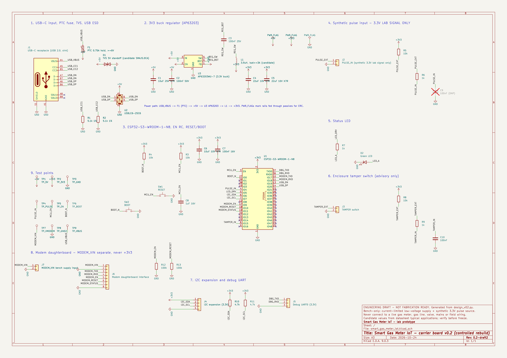

# Native KiCad project — carrier board v0.2

**Status: v0.2-draft2, ERC-clean engineering draft. Not reviewed, not frozen, not fabrication-ready.**
Bench-only prototype: current-limited low-voltage supply and a synthetic 3.3 V pulse source. Never connect it to a live gas meter, gas line, valve, mains or field wiring.



## What is here

| Path | Purpose |
|---|---|
| `design_v02.py` | **Single source of truth**: every part, value, footprint, candidate MPN and pin → net assignment |
| `tools/generate_schematic.py` | Generates the schematic, project file and project-local libraries from `design_v02.py` |
| `smart_gas_meter_iot.kicad_sch` / `.kicad_pro` | Native KiCad schematic (KiCad 7 file format; opens in KiCad 7, 8 and 9) |
| `lib/smart_gas_meter.kicad_sym`, `lib/SGM.pretty/` | Project-local copies of the KiCad 7.0.11 stock symbols/footprints actually used, so CI needs no global libraries |
| `sym-lib-table`, `fp-lib-table` | Project library tables (nickname `SGM`) |
| `check_netlist_matches_design.py` | Compares a KiCad-exported netlist with `design_v02.py`, pin by pin |
| `check_netlist_invariants.py` | Guardrail for the blocking faults found in the frozen draft (GND on supply rails, shorted capacitors, legacy dev-board headers, modem on 3V3) |
| `exports/` | Schematic PDF/PNG, KiCad 9 ERC report, exported netlist and generated BOM for `v0.2-draft2` |
| `archive/v0.2-frozen-2026-10-23/` | The frozen first draft, kept unchanged as evidence (65 ERC messages, +5V/GND short) |

## Circuit summary

1. **USB-C input** — USB 2.0 receptacle (J1), 5.1 kΩ Rd on CC1 and CC2 separately (R1/R2), PTC fuse (F1) from `USB_VBUS` to `+5V`, TVS (D1) on `+5V`, USBLC6-2SC6 ESD array (U2) on D+/D−.
2. **3V3 buck** — AP63203WU-7 (U3) with the datasheet typical application: 10 µF input, 3.9 µH inductor, 2 × 22 µF output, 100 nF bootstrap; EN tied to VIN.
3. **ESP32-S3-WROOM-1-N8** (U1) — 10 µF + 100 nF at 3V3; EN RC 10 kΩ/1 µF per Espressif guidelines; RESET (SW1) and BOOT/GPIO0 (SW2) buttons; native USB on GPIO19/GPIO20.
4. **Synthetic pulse input** (J2 → GPIO4) — 10 kΩ pull-up, 1 kΩ series resistor, optional DNP filter capacitor. 3.3 V logic or dry contact only.
5. **Status LED** on GPIO5. 6. **Tamper switch** input on GPIO15 with pull-up and RC debounce (advisory event only).
7. **I2C expansion** (GPIO6/7, 4.7 kΩ pull-ups) and **debug UART0** header (no power pin, to avoid back-feeding).
8. **Modem daughterboard connector** (J6) — UART on GPIO17/18, EN/RESET/STATUS on GPIO9/10/11 with safe-default pull-downs. `MODEM_VIN` comes from its own bench-supply connector (J7) and is **never** connected to `+3V3`.
9. **Test points** for 5V, 3V3, VBUS, VMODEM, GND (×2), PULSE_IN, EN and BOOT.

Distinct rails in the netlist: `USB_VBUS`, `+5V`, `+3V3`, `GND`, `MODEM_VIN`. Unused module GPIOs carry explicit no-connect flags (strapping pins GPIO3/45/46 stay at their default state).

## Verification evidence (2026-10-24)

| Check | Tool | Result |
|---|---|---|
| ERC | KiCad 9.0.3 `kicad-cli sch erc --exit-code-violations` | **0 errors, 0 warnings**, no exclusions or rule changes ([report](exports/erc-kicad-9.0.3.rpt)) |
| Netlist vs. design | `check_netlist_matches_design.py` | 48 parts, 28 nets, 135 pin connections match; NC pins match exactly |
| Electrical invariants | `check_netlist_invariants.py` | pass (the same checker reports 10 findings on the archived frozen draft) |
| Schematic ↔ design sync | `generate_schematic.py --check` | committed file is byte-identical to a fresh generation |

The CI workflow `hardware-cad-check.yml` repeats all four checks with KiCad 9 on every push that touches `hardware/kicad/`.

## Regenerate and verify locally

```bash
python3 hardware/kicad/tools/generate_schematic.py          # rewrite schematic + libraries from design_v02.py
kicad-cli sch erc --exit-code-violations hardware/kicad/smart_gas_meter_iot.kicad_sch   # KiCad 8/9
kicad-cli sch export netlist -o /tmp/sgm.net hardware/kicad/smart_gas_meter_iot.kicad_sch
python3 hardware/kicad/check_netlist_matches_design.py /tmp/sgm.net
python3 hardware/kicad/check_netlist_invariants.py /tmp/sgm.net
python3 -m unittest discover -s hardware/kicad/tests
```

To change the circuit, edit `design_v02.py`, regenerate, and commit the schematic, libraries and exports together. Hand edits in the KiCad editor are possible, but they must then be reflected back into `design_v02.py`, or the sync check fails.

## Still open before schematic freeze

- Select exact USB-C connector, PTC fuse, TVS and inductor SKUs; re-check footprints against manufacturer drawings (the footprints are stock KiCad candidates).
- Confirm AP63203 FB connection for the fixed-output variant, input/output capacitor ratings and thermal limits against the current datasheet.
- Independent review of the ESP32-S3 module pin map, strapping behaviour and EN timing against the Espressif datasheet and hardware design guidelines.
- Modem SKU, I/O voltage, enable/reset polarity and peak current; daughterboard level translation.
- Power budget for the PTC fuse rating; LED current after LED selection.

Only after this review is the PCB created from this exact schematic revision (`CONTROLLED_REBUILD_SPEC.md`, steps 6–9).

## Library licence

Symbols and footprints are copied from the KiCad 7.0.11 stock libraries (CC-BY-SA 4.0 with the KiCad library exception that permits use in designs without affecting the design's own licence). The archived frozen draft was adapted from MIT-licensed 74th/esp32-dev-boards material; see `REFERENCE_ATTRIBUTION_AND_STATUS.md`.
